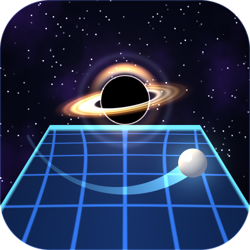

# Umbra



Table tennis where physics bends. The table stands in a strange place, and
something there changes how the ball flies: a black hole that pulls it in, a
turning station that curves it, an atomic nucleus that throws it back, the
physics of the ancients that sends it straight and then drops it. Every law can be seen
before the ball obeys it: the grid on the table bends with the force, the
ball's tail draws its path, and the room itself gives a hint.

Everything on the screen and everything you hear is made by the code: the 3D
is computed pixel by pixel on the processor, and the sounds are synthesized.

## Realms

- **The Lyceum, 335 BC.** The physics of the ancients, as if it were true: a
  ball flies straight while its impetus lasts, then falls to its natural place.
  A line and a plumb line show where; the cosmos lies in mosaic underfoot.
- **The hole.** A black hole drifts over the net. It pulls the ball, harder the
  closer it passes, and keeps whatever crosses its horizon. The grid on the
  table falls toward it like a funnel; it hums louder as the ball comes near.
- **The station.** A glass deck on a station turning in orbit. The turning
  room itself curves every ball, the same way from either end, and through the
  glass the stars and the planet wheel round at the rate of the spin: the ball
  turns the way the sky turns.
- **The nucleus, 1911.** A laboratory of boards, brass and chalk. An atomic
  nucleus pushes the ball away; a ball that comes straight at it may be thrown
  back to the side it came from. The grid is pressed into a knot under it, and
  the blackboard shows how particles scatter on a nucleus.

Every visit begins at the hole; after that each match is played in another
realm, in a shuffled order. With every level the opponent is quicker and
steadier, and each realm's force is stronger: the bend in the grid shows how
much.

## Playing

- Slide a finger to move your paddle. It rides a little above the finger, so
  the finger never hides it.
- Put the ring under the ball after it bounces on your side. Swipe forward to
  hit hard: a hard ball is fast but crosses the net low.
- Lift the finger to serve.
- The net is real: the mesh stops the ball, the cord deflects it. A serve that
  touches the net and still lands right is played again.

## Building

No IDE and no build system. The build tools of the Android SDK, a JDK and a
platform jar, API 34, are all it takes:

```sh
export ANDROID_JAR=/path/to/android.jar
export KEYSTORE=/path/to/your.keystore KEY_ALIAS=yourkey KS_PASS=yourpassword
./build.sh
```

The signed package is `out/umbra.apk`. It runs on Android 8.0 and newer.

The game itself has no platform classes, so it also runs on an ordinary JVM:
`stand/run.sh` plays a scene from a script and saves the frames as images,
the same frames the phone draws.

## License

0BSD. Do what you like with it.
